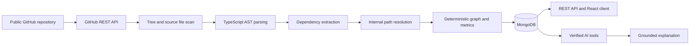

# CartoGraph

**Understand a codebase through its verified dependency graph.**

CartoGraph is a repository analysis platform for JavaScript and TypeScript projects. It reads a public GitHub repository at a specific commit, extracts dependencies with static AST analysis, stores the resulting graph, and provides tools to explore architecture and change impact. Optional AI chat explains repository information using verified files and graph data.

The graph is produced by static analysis. AI is used for explanations and does not create dependency relationships.

## Contents

- [Features](#features)
- [How analysis works](#how-analysis-works)
- [Project structure](#project-structure)
- [Requirements](#requirements)
- [Local development](#local-development)
- [Environment configuration](#environment-configuration)
- [Docker](#docker)
- [Application routes](#application-routes)
- [API reference](#api-reference)
- [Data model](#data-model)
- [Quality checks](#quality-checks)
- [Security and analysis boundaries](#security-and-analysis-boundaries)
- [License](#license)

## Features

### Repository analysis

- Accepts public GitHub repository URLs and analyzes a selected commit SHA.
- Reads repository trees and source blobs through the GitHub REST API; it does not clone or execute repository code.
- Scans `.ts`, `.tsx`, `.js`, `.jsx`, `.mjs`, and `.cjs` files.
- Excludes common generated or vendored directories such as `node_modules`, `.git`, `dist`, `build`, `coverage`, `.next`, `.cache`, and `vendor`.
- Extracts static imports, re-exports, dynamic imports, and `require()` calls with source line numbers.
- Resolves relative references to files in the scanned repository and leaves package imports out of the internal graph.
- Builds deterministic directed graphs and calculates fan-in and fan-out.

### Architecture exploration

- Displays analysis status, file metadata, dependency edges, and project statistics.
- Finds shortest dependency paths and direct or transitive dependents.
- Calculates the blast radius of a file using reverse graph traversal.
- Classifies common file roles with deterministic path-based rules.

### Projects, accounts, and chat

- Provides registration, login, logout, and current-user endpoints using JWT authentication.
- Associates projects and analyses with their owner and checks ownership in protected API flows.
- Queues analysis work through BullMQ and Redis so repository processing runs outside HTTP requests.
- Provides optional LangChain/LangGraph chat tools that retrieve verified analysis data. AI chat requires an OpenAI API key; static analysis does not.
- Includes a React interface with public home/auth pages and authenticated dashboard, project, analysis, graph, file, chat, and settings routes.

## How analysis works



Analysis work follows this lifecycle:

1. The API checks project ownership, creates a queued analysis, and enqueues a small BullMQ job.
2. The worker fetches the requested commit and source tree from GitHub.
3. The scanner applies extension, directory, and size limits.
4. `ts-morph` parses source without executing it and extracts dependency candidates.
5. The resolver maps relative imports to scanned files; external package imports are not graph nodes.
6. The graph builder calculates file roles, fan-in, fan-out, and edges.
7. The worker stores file and dependency metadata and marks the analysis completed or failed.

Configured scan limits are 5,000 files, 1 MB per file, and 25 MB total source content. Files are fetched in small batches. Source content is used for parsing and hashing; the persisted analysis model stores file metadata and dependency relationships.

## Project structure

```text
CartoGraph/
├── client/                 React + TypeScript + Vite application
│   ├── src/pages/           Page-level UI
│   ├── src/components/      Shared and feature components
│   ├── src/services/        API clients and feature services
│   └── src/styles/          Global styles and design tokens
├── server/                 Express + TypeScript API and worker
│   ├── src/analysis/         GitHub source scanning and graph pipeline
│   ├── src/controllers/      HTTP request handlers
│   ├── src/models/           Mongoose schemas and model types
│   ├── src/queues/           BullMQ analysis queue
│   ├── src/repositories/     Database access
│   ├── src/routes/           REST route registration
│   ├── src/services/         Application logic
│   └── src/workers/          Background analysis worker
├── docker/                  Dockerfile and Compose configuration
├── frontend-design/         Local design references (git-ignored)
└── README.md
```

The client and server are separate npm applications with separate dependency manifests and configuration. During development, the Vite client calls the API at the URL configured by `VITE_API_BASE_URL`.

## Requirements

- Node.js 22 or newer
- npm
- MongoDB 8 or a compatible MongoDB service
- Redis 7 or a compatible Redis service
- Docker Desktop / Docker Engine with Compose (optional, for local infrastructure)
- A GitHub token is optional but recommended for higher GitHub API rate limits.
- An OpenAI API key is optional and is only needed for AI chat.

## Local development

### 1. Install dependencies

Install the root tooling and each application independently:

```bash
npm ci
npm ci --prefix client
npm ci --prefix server
```

### 2. Configure environment files

```bash
cp server/.env.example server/.env
cp client/.env.example client/.env
```

Set `JWT_SECRET` in `server/.env` to a private random value with at least 32 characters. For example, generate one locally with:

```bash
openssl rand -base64 32
```

Do not commit `.env` files. They are ignored by Git.

### 3. Start MongoDB and Redis

To run only the infrastructure containers:

```bash
docker compose -f docker/docker-compose.yml up -d mongodb redis
```

Compose exposes MongoDB on host port `27018` and Redis on `6379`. If using these containers with the backend running directly on your host, set:

```dotenv
MONGO_URI=mongodb://127.0.0.1:27018/cartograph
REDIS_URL=redis://127.0.0.1:6379
```

If MongoDB is installed directly on your machine, the example `MONGO_URI` uses port `27017` by default.

### 4. Run the API and client

Start the backend in one terminal:

```bash
npm run server:dev
```

Start the frontend in another terminal:

```bash
npm run dev --prefix client
```

The client is served at `http://localhost:5173`. The API listens at `http://localhost:5000`; its health endpoint is `http://localhost:5000/health`.

## Environment configuration

### Server (`server/.env`)

| Variable            | Required | Default / example                      | Purpose                                               |
| ------------------- | -------- | -------------------------------------- | ----------------------------------------------------- |
| `NODE_ENV`          | No       | `development`                          | Runtime mode: `development`, `test`, or `production`. |
| `PORT`              | No       | `5000`                                 | HTTP API port.                                        |
| `MONGO_URI`         | Yes      | `mongodb://127.0.0.1:27017/cartograph` | MongoDB connection string.                            |
| `REDIS_URL`         | No       | `redis://127.0.0.1:6379`               | Redis connection used by BullMQ and rate limiting.    |
| `CLIENT_URL`        | No       | `http://localhost:5173`                | Allowed browser origin for CORS.                      |
| `JWT_SECRET`        | Yes      | Set locally; 32+ characters            | Secret used to sign and verify JWTs.                  |
| `JWT_EXPIRES_IN`    | No       | `7d`                                   | JWT expiration value.                                 |
| `GITHUB_TOKEN`      | No       | Empty                                  | Optional token for GitHub API access.                 |
| `OPENAI_API_KEY`    | No       | Empty                                  | Enables AI chat when configured.                      |
| `OPENAI_MODEL`      | No       | `gpt-4o-mini`                          | OpenAI model used by the chat agent.                  |
| `LANGSMITH_API_KEY` | No       | Empty                                  | Optional LangSmith tracing credential.                |
| `LANGSMITH_TRACING` | No       | `false`                                | Enables LangSmith tracing when set to `true`.         |
| `LANGSMITH_PROJECT` | No       | `CartoGraph`                           | LangSmith project name.                               |
| `LOG_LEVEL`         | No       | `info`                                 | Pino log level.                                       |

### Client (`client/.env`)

| Variable            | Default / example       | Purpose                       |
| ------------------- | ----------------------- | ----------------------------- |
| `VITE_API_BASE_URL` | `http://localhost:5000` | Base URL for the Express API. |

All client-side environment variables must use the `VITE_` prefix. Never put private credentials in client environment variables; values bundled into the frontend are public.

## Docker

The Compose file starts MongoDB, Redis, and the backend. The client remains a separate Vite application.

```bash
cp server/.env.example server/.env
```

Edit `server/.env` and set a private `JWT_SECRET` before starting the stack:

```bash
npm run docker:up
```

Compose uses the internal service addresses `mongodb:27017` and `redis:6379` for the backend. It exposes the API on port `5000`, Redis on `6379`, and MongoDB on host port `27018`.

Useful root commands:

```bash
npm run docker:build
npm run docker:up
npm run docker:logs
npm run docker:down
```

To run the client with the Docker API, set `VITE_API_BASE_URL=http://localhost:5000` in `client/.env` and run `npm run dev --prefix client`.

## Application routes

The React application defines these browser routes:

| Route                                              | Page                          |
| -------------------------------------------------- | ----------------------------- |
| `/`                                                | Public landing page           |
| `/login`                                           | Sign in                       |
| `/register`                                        | Create an account             |
| `/dashboard`                                       | Project and analysis overview |
| `/projects`                                        | Project list                  |
| `/projects/:projectId`                             | Project details               |
| `/analyses`                                        | Analysis history              |
| `/analyses/:analysisId`                            | Analysis overview             |
| `/analyses/:analysisId/progress`                   | Analysis progress             |
| `/analyses/:analysisId/graph`                      | Dependency graph              |
| `/analyses/:analysisId/files`                      | Analysis files                |
| `/analyses/:analysisId/files/:fileId`              | File details                  |
| `/analyses/:analysisId/path`                       | Dependency path explorer      |
| `/analyses/:analysisId/files/:fileId/blast-radius` | Blast radius                  |
| `/analyses/:analysisId/chat`                       | Repository chat               |
| `/settings`                                        | Account and UI settings       |

OAuth provider buttons are not connected to OAuth endpoints. Sign-in and registration use the backend email/password API.

## API reference

Business API routes are prefixed with `/api`; the health endpoint is `/health`. Except registration and login, the routes below require a valid bearer token. Project, analysis, file, and chat operations also enforce ownership checks in the backend.

### Health

| Method | Path      | Description          |
| ------ | --------- | -------------------- |
| `GET`  | `/health` | API health response. |

### Authentication

| Method | Path                 | Description                                      |
| ------ | -------------------- | ------------------------------------------------ |
| `POST` | `/api/auth/register` | Create an account (`name`, `email`, `password`). |
| `POST` | `/api/auth/login`    | Sign in (`email`, `password`).                   |
| `POST` | `/api/auth/logout`   | Revoke the current session token.                |
| `GET`  | `/api/auth/me`       | Return the current safe user profile.            |

### Projects and analyses

| Method   | Path                         | Description                                                       |
| -------- | ---------------------------- | ----------------------------------------------------------------- |
| `POST`   | `/api/projects`              | Create a project (`name`, `githubUrl`, optional `defaultBranch`). |
| `GET`    | `/api/projects`              | List the authenticated user’s projects.                           |
| `GET`    | `/api/projects/:id`          | Get project details.                                              |
| `PATCH`  | `/api/projects/:id`          | Update project fields.                                            |
| `DELETE` | `/api/projects/:id`          | Delete a project.                                                 |
| `GET`    | `/api/projects/:id/analyses` | List a project’s analyses.                                        |
| `POST`   | `/api/analyses`              | Queue an analysis (`projectId`, 40- or 64-character `commitSha`). |
| `GET`    | `/api/analyses/:id`          | Get analysis details.                                             |
| `GET`    | `/api/analyses/:id/status`   | Get processing status and timestamps.                             |
| `GET`    | `/api/analyses/:id/stats`    | Get file, dependency, role, language, and graph metrics.          |

Analysis statuses are `queued`, `processing`, `completed`, and `failed`. Creating an analysis returns an ID; processing happens asynchronously.

### Graph, files, dependencies, and chat

| Method   | Path                                           | Description                                                          |
| -------- | ---------------------------------------------- | -------------------------------------------------------------------- |
| `GET`    | `/api/analyses/:id/graph`                      | Get verified graph nodes and edges.                                  |
| `GET`    | `/api/analyses/:id/files`                      | List files in an analysis.                                           |
| `GET`    | `/api/analyses/:id/files/:fileId`              | Get file metadata.                                                   |
| `GET`    | `/api/files/:fileId`                           | Get file metadata by ID.                                             |
| `GET`    | `/api/analyses/:id/files/:fileId/dependencies` | List outgoing dependencies.                                          |
| `GET`    | `/api/analyses/:id/files/:fileId/dependents`   | List incoming dependencies/dependents.                               |
| `GET`    | `/api/dependencies/:fileId`                    | List outgoing dependencies by file ID.                               |
| `GET`    | `/api/dependencies/:fileId/dependents`         | List dependents by file ID.                                          |
| `GET`    | `/api/analyses/:id/files/:fileId/blast-radius` | Calculate the file’s direct and transitive impact.                   |
| `POST`   | `/api/analyses/:id/path`                       | Find a dependency path (`sourceFileId`, `targetFileId`).             |
| `POST`   | `/api/analyses/:id/chat`                       | Ask a repository question (`message`, optional `sessionId`).         |
| `POST`   | `/api/chat/sessions`                           | Create a chat session (`projectId`, `analysisId`, optional `title`). |
| `GET`    | `/api/chat/sessions/:id`                       | Get a chat session.                                                  |
| `GET`    | `/api/chat/sessions/:id/messages`              | List session messages.                                               |
| `DELETE` | `/api/chat/sessions/:id`                       | Delete a chat session and its messages.                              |

Protected requests use:

```http
Authorization: Bearer <token>
```

Successful API responses use `{ "success": true, "data": ... }`. Errors use `{ "success": false, "message": "..." }`.

## Data model

MongoDB stores these entities:

- **User** — name, normalized email, password hash, and timestamps.
- **Project** — owner, GitHub URL, repository metadata, and default branch.
- **Analysis** — project, exact commit SHA, status, file/dependency counts, timestamps, and failure message.
- **File** — analysis, path, language, deterministic role, line count, fan-in/fan-out, and content hash.
- **Dependency** — analysis, source and target file IDs, dependency kind, and source line.
- **Chat session** — project, analysis, title, and timestamps.
- **Chat message** — session, role, message content, and citations.

Indexes support owner/project lookups and unique file paths and dependency relationships within an analysis.

## Quality checks

Run checks from each application directory:

```bash
# Frontend
npm run check --prefix client
npm run test --prefix client

# Backend
npm run check --prefix server
npm run test --prefix server
```

Each `check` script runs TypeScript checking, Prettier validation, ESLint, and a production build. The root-level `npm run check` and `npm run test` scripts currently target the backend only; run the client commands separately.

Other useful commands include `npm run test:watch --prefix client`, `npm run test:watch --prefix server`, and `npm run test:coverage --prefix server`.

## Security and analysis boundaries

- Repository URLs are validated as public GitHub repository URLs.
- Downloaded repository code is never executed; package scripts and dependency installation are never run for analyzed repositories.
- AST analysis—not the LLM—determines internal dependency relationships.
- API inputs are validated with Zod, passwords are hashed, and protected routes verify project ownership.
- `JWT_SECRET` must be private and at least 32 characters. Do not commit `.env` files or expose server secrets through `VITE_` variables.
- GitHub, OpenAI, and LangSmith credentials are optional environment configuration, not source-code constants.

## Azure Deployment & Cost Management ($100 Credit)

CartoGraph is architected for zero/near-zero idle cost on Azure:
- **Frontend**: Azure Static Web Apps (Free tier — $0.00/mo, 100 GB bandwidth, free SSL, global CDN).
- **Backend & Worker**: Azure Container Apps (Consumption tier — Free monthly grant of 180,000 vCPU-s, 360,000 GiB-s, 2M requests; scales to 0 replicas when idle).
- **Database**: MongoDB Atlas M0 (Free forever tier — 512 MB storage, shared RAM, replica set, zero Azure credit consumed).
- **Redis & Queues**: Lightweight Container App running Redis (or Upstash Redis Free tier / Azure Managed Redis).

### Deploying with Azure CLI & Bicep

1. Sign in to your Azure account in your local terminal (never share tokens or credentials in chat):
   ```bash
   az login
   az account set --subscription "<YOUR_SUBSCRIPTION_ID>"
   ```

2. Create a resource group:
   ```bash
   az group create --name cartograph-rg --location eastus2
   ```

3. Set up a Budget Alert to safeguard your $100 credit:
   ```bash
   az consumption budget create \
     --budget-name "cartograph-budget" \
     --amount 80 \
     --time-grain Monthly \
     --start-date "$(date +%Y-%m-01)" \
     --end-date "$(date -d '+1 year' +%Y-%m-01)" \
     --resource-group cartograph-rg
   ```

4. Deploy the infrastructure:
   ```bash
   az deployment group create \
     --resource-group cartograph-rg \
     --template-file ./infra/main.bicep \
     --parameters ./infra/main.parameters.json \
     --parameters \
       jwtSecret="<GENERATED_32_CHAR_SECRET>" \
       mongoUri="<YOUR_MONGODB_URI>" \
       redisUrl="<YOUR_REDIS_URL>"
   ```

### GitHub Secrets for CI/CD

Configure these secrets in your GitHub repository (`Settings` > `Secrets and variables` > `Actions`):

| Secret Name | Description | Secret? |
|-------------|-------------|---------|
| `AZURE_CLIENT_ID` | Service Principal Client ID (OIDC) | Yes |
| `AZURE_TENANT_ID` | Azure Active Directory Tenant ID | Non-secret ID |
| `AZURE_SUBSCRIPTION_ID` | Azure Subscription ID | Non-secret ID |
| `AZURE_RESOURCE_GROUP` | e.g. `cartograph-rg` | Non-secret ID |
| `AZURE_STATIC_WEB_APPS_API_TOKEN` | Deployment token from Azure Portal Static Web App | Yes |
| `VITE_API_BASE_URL` | Deployed Container App URL (e.g. `https://cartograph-api...`) | Non-secret URL |
| `JWT_SECRET` | Secure random 32+ character string | Yes |
| `MONGO_URI` | MongoDB connection string (Atlas M0) | Yes |
| `REDIS_URL` | Redis connection URL (`redis://` or `rediss://`) | Yes |
| `APP_GITHUB_TOKEN` | Optional GitHub PAT for higher API rate limits | Yes (Optional) |
| `OPENAI_API_KEY` | Optional OpenAI API key for codebase chat | Yes (Optional) |

### Stopping & Deleting Resources (Cleanup)

To immediately stop all compute and prevent further credit consumption:
```bash
# Delete entire resource group when done:
az group delete --name cartograph-rg --yes --no-wait
```

## License

The root `package.json` declares the ISC license. A standalone `LICENSE` file is not currently present; add one before redistributing the project if you need the license terms included with the repository.
